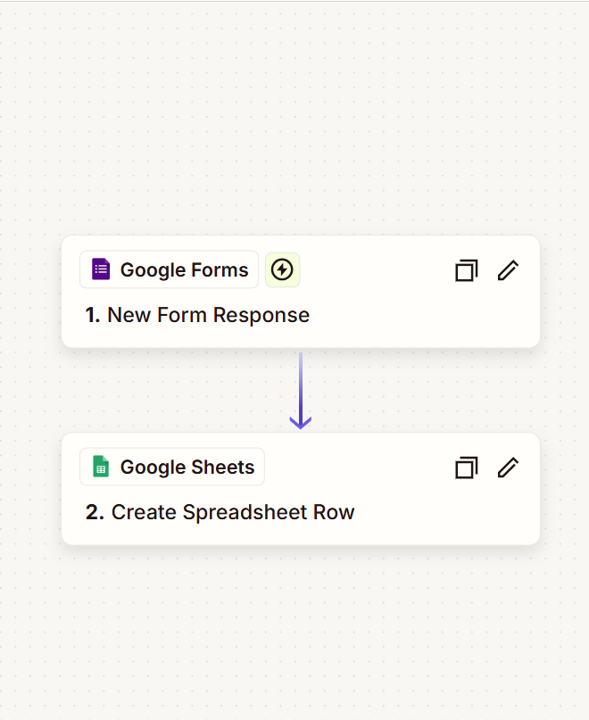
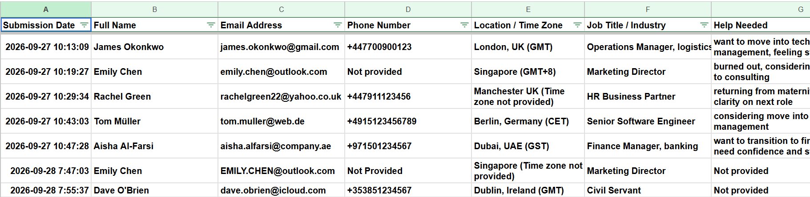
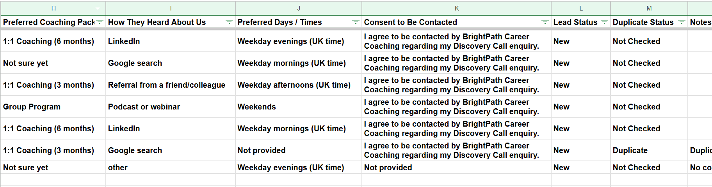

# Discovery Call Intake Automation

**Fictional Practice Project | Administrative Virtual Assistant**

*Tools: Google Forms · Zapier · Google Sheets*

> **Project disclosure:** This is a fictional practice project created for portfolio demonstration. All company details and submission data are fictional. No real client data was used.

## 1. Project Overview

This project explores how a simple automation workflow can help a coaching business organise incoming discovery call enquiries.

The goal was to connect Google Forms, Zapier, and Google Sheets so that new submissions could be captured automatically in one central tracker, without manually copying information from email notifications.

## 2. The Problem

In this fictional scenario, BrightPath Career Coaching receives 15–30 discovery call enquiries per week.

The existing process relies on email notifications and manual data entry into a Google Sheet.

This creates several administrative challenges:

- Enquiries may be missed in a busy inbox.
- Duplicate records can be created.
- Contact details may contain copying or formatting errors.
- Missing information is not always obvious.
- The team lacks one reliable place to review all enquiries.

The business needs a more organised and reliable intake process.

## 3. The Solution

I built and tested a workflow using:

**Google Form → Zapier → Google Sheets**

The workflow consists of:

1. A prospect submits the discovery call form.
2. Zapier captures the new form response.
3. The submitted information is mapped to the corresponding columns in Google Sheets.
4. A new row is created automatically in the Discovery Call Tracker.
5. Each new record receives a default `New` lead status and a `Not Checked` duplicate status.
This creates a central record of incoming enquiries and removes the need for manual copy-and-paste during data capture.

### Workflow Screenshot

*The Zap captures new form responses and creates a row in the discovery call tracker.*

## 4. Handling Data Quality Challenges

I tested the workflow using seven intentionally inconsistent sample submissions.

The test data included:

- **Inconsistent name formatting:** Names appeared in different capitalisation formats.
- **International phone numbers:** Country codes and phone number formatting needed careful handling.
- **Missing information:** Some optional or test fields were left blank.
- **Duplicate submission:** Emily Chen appeared twice with slightly different details.
- **Missing consent:** One submission did not include consent to be contacted.

### How I handled the data

**Standardisation:** I made name capitalisation and date display formats consistent in the tracker.

**Phone number formatting:** I established a consistent input example and adjusted the spreadsheet display format for readability.

**Missing information:** Blank fields were labelled `Not provided` where appropriate, rather than left unexplained.

**Duplicate review:** The repeated Emily Chen record was identified during review, marked `Duplicate`, and given a note linking it to the earlier submission. It was not silently deleted.

**Consent handling:** The submission without consent was clearly flagged for review rather than treated as permission to contact the person.

These data-cleaning and review steps were performed separately from the basic Zapier intake workflow.
### Discovery Call Tracker

 

*The tracker provides a central view of submissions, lead status, duplicate flags, and missing information.*

## 5. Outcome

Testing confirmed that the form responses could be sent to Google Sheets automatically.

The project produced:

- A working Form → Zapier → Sheets intake workflow.
- A central tracker with clearly labelled columns.
- Seven test submissions for reviewing data quality.
- A separate field for duplicate status.
- Clear labels for missing information.
- A repeatable structure for reviewing incoming enquiries.

This was a practice project, so no real client time savings, revenue increases, or conversion improvements were measured.

## 6. Key Learnings

This project taught me that setting up an automation is only one part of improving an administrative process.

A reliable workflow also requires:

- A clear process before automation begins.
- Accurate data mapping.
- Consistent formatting rules.
- A plan for missing information and duplicate submissions.
- Human review when the right decision cannot be determined from the available data.
- Ongoing testing, monitoring, and maintenance as business processes change.

**My key takeaway:** Automation can move data automatically, but the process still needs clear rules, careful review, and maintenance to remain reliable.

## 7. Tools Used

- Google Forms — enquiry intake
- Zapier — workflow automation
- Google Sheets — central discovery call tracker

## 8. Project Scope

This project focused only on the **Form → Zapier → Sheet** workflow.

It did not include AI processing, automatic email replies, scheduling links, or CRM integrations.

Duplicate identification and data cleaning were handled through review rather than fully automated decision-making.

---

*This project demonstrates my approach to administrative workflow organisation, data accuracy, duplicate review, and practical automation using a beginner-friendly tool stack.*
